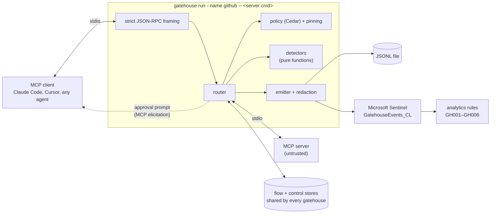

# gatehouse

[](https://github.com/danielguillaumont/gatehouse/actions/workflows/ci.yml)
[](https://github.com/danielguillaumont/gatehouse/actions/workflows/secrets.yml)
[](LICENSE)

**A security proxy for AI agents' MCP tool calls. It keeps prompt injection from
turning into exfiltration even when the injection isn't detected, blocks rug pulls and
credential leaks, and gives the SOC redacted events and tested Microsoft Sentinel
detections.**


*A weather server is approved, then "updated" with a hidden instruction to read
`~/.ssh/id_rsa`. gatehouse notices that the definition changed, hides the tool from the
agent, blocks the call and logs the detection. Source: [`demo/`](demo/README.md).*

## What it does

- **Enforces** a YAML policy and pins tool definitions, so a server can't change a tool
  after you approved it (rug pull). Risky calls can require a human yes through the MCP
  client's own prompt. Everything fails closed.
  - Rules can check arguments: recipient domains, URL hosts, path roots, numeric limits.
  - The policy compiles to Cedar, and `gatehouse policy prove` checks invariants such as
    "no delete tool is ever allowed without approval" in CI, including with Cedar's
    symbolic compiler.
- **Contains** prompt injection it can't detect. Session flow control applies the Rule
  of Two across every server the agent uses: once a session has read untrusted input and
  private data, an egress or state-changing call needs a human (or is blocked).
  - This works whatever the injection says, in any order.
  - Provenance fingerprints show when private text, or its base64, hex or URL-encoded
    form, is being sent out.
- **Responds:**
  - quarantine with `gatehouse review`;
  - a circuit breaker that locks a session after repeated high findings;
  - a kill switch (file, signal or CLI);
  - scoped grants and an approval budget against approval fatigue.
- **Inspects** tool listings, arguments and results for tool poisoning, prompt injection,
  secrets, credential paths, dangerous commands and personal data, using bounded,
  ReDoS-safe rules.
- **Reports** every decision as a redacted event in a published schema
  (`GatehouseEvents_CL`): no argument values, no secrets, only HMAC fingerprints. Six
  Sentinel analytics rules, including cross-server injection-then-exfiltration, are tested
  in a real Kusto engine in CI.

## How it's measured

A target-agnostic attack suite: 95 attacks and 29 benign scenarios, each a YAML file
with a success condition checked at the mock server. A false positive is any change to
benign traffic: a hidden tool, a blocked call or an edited result.

**Cross-server exfiltration chains (v0.2.0).** These come from GitHub Actions run
[46101039038](https://github.com/danielguillaumont/gatehouse/actions/runs/46101039038)
at commit `e5d7b7c` (`python -m attacks flow`).
- There are eight chains across notes, web, mail, issue and file servers, each server
  behind its own gatehouse. The injections are polite requests that no content rule
  flags.
- The scripted agent always follows the injection.
- The simulated user declines gatehouse's prompts during attacks and accepts them
  during benign tasks.

| flow.mode | Chains completed | Benign tasks passed | Approvals per benign task |
|---|---|---|---|
| monitor | 6 / 8 | 6 / 6 | 0.00 |
| **approve** | **0 / 8** | **6 / 6** | **0.50** (3 tasks need 1 prompt, 3 need none) |
| enforce | 0 / 8 | 3 / 6 | 0.00 |

Every chain was stopped by flow control itself (the Rule of Two), not by spotting the
injection; one of them sends a paraphrase that no copy detector could match.
[Details and limits](docs/evaluation.md#session-flow-control-m5).

**Against other gateways (v0.1.0).** The same suite ran through gatehouse and the two
other stdio MCP gateways, on the same CI runner, from the same commit. It had 75 attacks
and 16 benign scenarios then:

| [Run 45507937200](docs/evaluation.md#competitor-comparison-m3), 2026-11-24 | gatehouse 0.1.0 | gateward 0.3.0 | mcp-watchdog 0.1.9 |
|---|---|---|---|
| **Benign false positives** (16 scenarios) | **2** | 6 | 0 |
| Benign scenarios with an alert | 2 | not measured¹ | 8 |
| Held-out attacks prevented (18, written after the detectors) | 6 | 7 | 1 (+9 alerted) |
| Suite attacks prevented (MVP + M2 sets)² | 53 / 54 | 16 / 52 | 3 / 52 (+18 alerted) |

¹ gateward writes alerts to a SQLite audit log the harness doesn't read.
² The MVP and M2 sets were written alongside gatehouse's detectors, so they mostly show
that its controls do what they were designed to do. gateward and mcp-watchdog face 52, not
54: two self-protection scenarios target gatehouse's own files.

On attacks it wasn't designed around, gatehouse prevents 6 of 18. Rules that match
*structure*, such as token formats, credential paths and reverse-shell shapes, generalize.
Rules that match *wording* don't. That's why the primary controls are pinning, policy and
approval, with content detection as high-signal telemetry. Every miss is listed with a
reproducing scenario in [`docs/known-bypasses.md`](docs/known-bypasses.md). Scoring
details and caveats, including that I wrote the suite, are in
[`docs/evaluation.md`](docs/evaluation.md).

Added latency for a 1 KiB tool call, p95 (`uv run python -m bench.latency`, CI run
46101039038, Ubuntu):
- +1.98 ms with the Cedar engine (Cedar's share is about 0.2 ms);
- +2.67 ms with flow control on.

The v0.1 figure was +4.35 ms on a Windows laptop. Details are in
[`docs/evaluation.md`](docs/evaluation.md#latency).

## Architecture



One gatehouse process per server. They share an `AgentSessionId` and two local SQLite
stores:
- the **flow store** holds which capability labels the session has collected, plus
  provenance fingerprints;
- the **control store** holds the kill switch state, locks, quarantine and grants.

So a decision on the mail server knows what the agent read through the web server
([ADR-0005](docs/adr/0005-session-flow-control.md),
[ADR-0006](docs/adr/0006-response-controls.md)). Sentinel can correlate across servers
too: for example, an injection in a web page fetched on one server
followed by a message sent on another (GH006). The proxy works at the message level:
unknown methods and fields are forwarded byte for byte. More in
[`docs/architecture.md`](docs/architecture.md).

## Quick start

Requires Python 3.11+ and [uv](https://docs.astral.sh/uv/). Works on Windows and Linux.

```
git clone https://github.com/danielguillaumont/gatehouse && cd gatehouse
uv sync

uv run python demo/run_demo.py      # the rug-pull demo above, about 30 s

# Your own server: approve (pin) its tools, then run it through gatehouse
uv run gatehouse pin --name weather -- uv run python demo/weather_server.py
uv run gatehouse run --name weather --policy demo/policy.yaml -- uv run python demo/weather_server.py
```

With Claude Code:

```
claude mcp add weather -- uv run gatehouse run --name weather --policy demo/policy.yaml -- uv run python demo/weather_server.py
```

Over Streamable HTTP, `gatehouse serve` is a reverse proxy in front of the server's URL.
It needs the `http` extra (`uv sync --extra http`):

```
uv run gatehouse serve --name weather --policy demo/policy.yaml --upstream http://127.0.0.1:8000/mcp
claude mcp add --transport http weather http://127.0.0.1:8848/mcp
```

It listens on loopback unless you pass `--allow-remote`. It never forwards the client's
`Authorization` header or cookies: give it its own upstream credential with
`--upstream-bearer-env VAR`. In 2026-07-28 requests it rejects routing headers that
disagree with the body, and it rebuilds every upstream header from the body it
inspected ([ADR-0003](docs/adr/0003-http-reverse-proxy.md)).

With `--oidc-issuer` and `--oidc-audience` (for example Entra ID,
`https://login.microsoftonline.com/<tenant>/v2.0`), it is an OAuth resource server.
Every request needs a valid bearer token for this audience, checked against the
issuer's JWKS. The caller becomes the Cedar principal, and refusals are logged as
`auth.denied` ([ADR-0008](docs/adr/0008-http-authorization.md)).

Both transports speak MCP 2024-11-05 through 2025-11-25 (the `initialize` handshake) and
2026-07-28 (per-request `_meta`, `server/discover`, input rounds), with the same policy
and detections on each ([ADR-0002](docs/adr/0002-protocol-eras.md)). In 2026-07-28,
approval prompts are an input round that gatehouse signs and binds to the exact call
([ADR-0004](docs/adr/0004-mrtr-approval.md)).

A policy is a short YAML file. An invalid one blocks everything.

```yaml
version: 1
default_action: block        # required: allowlist style
pinning: strict              # strict | tofu | "off"
flow: {mode: approve}         # Rule of Two across servers: monitor | approve | enforce
servers:
  github:
    tools:
      "list_*": allow
      "merge_*": {action: require_approval, reason: "Merges need a human"}
      delete_repo: block     # an explicit block always wins
  mail:
    tools:
      send_email:
        action: allow
        when: {to: {email_domains: [mycorp.com]}}   # anyone else needs approval
        otherwise: require_approval
    labels: {send_email: [egress], "read_*": [untrusted_input, private_data]}
```

See [`docs/policy.md`](docs/policy.md) for conditions, labels, flow control, response
controls and `policy prove`.

| Command | What it does |
|---|---|
| `gatehouse run --name N --policy P -- CMD...` | Proxy one stdio MCP server (stdout carries only MCP) |
| `gatehouse serve --name N --policy P --upstream URL` | Proxy one Streamable HTTP MCP server |
| `gatehouse pin --name N [--tool T] -- CMD...` | Approve the server's current tool definitions |
| `gatehouse diff --name N -- CMD...` | Show what changed since approval (exit 1 on drift) |
| `gatehouse validate-policy P` / `policy-hash P` | Check a policy, or print its hash for `--expect-policy-sha256` |
| `gatehouse policy compile P [--out DIR]` / `policy prove P --invariants I` | Compile a policy to Cedar; prove invariants (exit 1 if one fails) |
| `gatehouse status` | Kill switch, locked sessions, quarantine and grants |
| `gatehouse kill [--reason R]` / `kill --off` | Engage or release the kill switch for every gatehouse on the machine |
| `gatehouse review [show\|release\|discard ID]` | Review results gatehouse withheld; a released one is delivered on the agent's next identical call |
| `gatehouse grant add S T --when C --for 30m` / `grant list` / `grant revoke ID` | Scoped approval, e.g. `send_email` to `@mycorp.com` for 30 minutes |
| `gatehouse unlock [--session ID]` | Unlock a session the circuit breaker locked |
| `gatehouse table-schema` | Print the `GatehouseEvents_CL` column schema |

## Detections

| Rule | Fires on |
|---|---|
| GH001 | Tool definition changed after approval (rug pull) |
| GH002 | Unapproved tool offered, or a hidden tool invoked |
| GH003 | Credential in the arguments of an egress or exec tool |
| GH004 | Policy tampering or load failure, self-protection hit, telemetry loss |
| GH005 | Burst of blocked calls in one agent session |
| GH006 | Injection in a tool result, then egress through a different server |

The rules live in `detections/rules/` in the Azure-Sentinel repository format, with
hunting queries in `detections/hunting/`. CI runs every rule against sample data
generated from real gatehouse sessions, in the Kusto emulator, and compares the results
with `detections/expected.yaml`. Bicep for the table, ingestion endpoint, data
collection rule and rules is in `infra/`. It's built and compiled in CI, but hasn't been
deployed; see [`docs/sentinel-setup.md`](docs/sentinel-setup.md).

## Docs

| | |
|---|---|
| [Architecture](docs/architecture.md) · [Threat model](docs/threat-model.md) · [ADR-0001: fail closed](docs/adr/0001-fail-closed.md) | how it works and why |
| [Policy](docs/policy.md) · [Event schema](docs/event-schema.md) · [Sentinel setup](docs/sentinel-setup.md) | using it |
| [Evaluation](docs/evaluation.md) · [Known bypasses](docs/known-bypasses.md) · [Prior art](docs/prior-art.md) | how well it works, and what else exists |
| [Decisions](docs/decisions.md) · [Security policy](SECURITY.md) | the record |

## Development

```
uv run pytest -q          # set GATEHOUSE_KUSTO_URL to include the KQL tests
uv run ruff check . && uv run ruff format --check .
uv run pyright            # strict
uv run python -m attacks run --target gatehouse --out reports/gatehouse
uv run python -m bench.latency
```

CI runs on Ubuntu and Windows with Python 3.11 to 3.13. It also runs the attack suite
with a canary check (no planted secret may reach any log), the Kusto tests, a Bicep build
and a full-history gitleaks scan.

MIT licensed. Report vulnerabilities privately; see [SECURITY.md](SECURITY.md).
